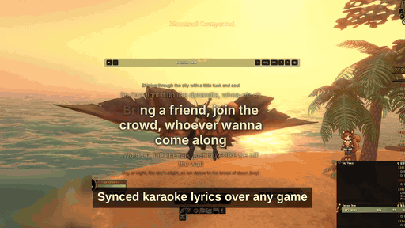
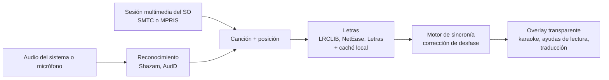

<!-- vitrina:translation-of README.md sha256=0ed47ea8d65ae8f1e19bf6d07a396c4176ce3d17eaa73761e0062d17991c1360 -->
# Singevery

Singevery es un overlay transparente de escritorio que reconoce la canción que suena y muestra la letra sincronizada, estilo karaoke, encima de cualquier app o juego.

[English](README.md) · [](https://github.com/Grizaceo/Singevery/releases/latest) [](https://github.com/Grizaceo/Singevery/actions/workflows/ci.yml)

<p align="center">
  
</p>

<p align="center"><a href="https://github.com/Grizaceo/Singevery/releases/download/v0.2.1-beta.4/singevery-trailer.mp4">▶ Ver el tráiler completo con sonido (68 s, MP4)</a></p>

## Estado

Beta pública. Funciona en **Windows (x64)** y **Linux (x64, Wayland o X11)**; la versión de Linux está probada en Hyprland. La interfaz viene en inglés y se puede cambiar a español en Ajustes. Es gratis y de código abierto.

## Cómo correrlo

1. Descarga la última versión desde **[Releases](https://github.com/Grizaceo/Singevery/releases/latest)**:
   - **Windows:** `Singevery-Setup-x.y.z.exe`. El instalador no está firmado, así que SmartScreen puede mostrar *"Windows protegió tu PC"*: pulsa **Más información → Ejecutar de todas formas**.
   - **Linux:** `Singevery-x.y.z-x86_64.AppImage` (dale `chmod +x` y ábrelo), o el `.tar.gz`. Detalles en [`apps/desktop/LINUX.md`](apps/desktop/LINUX.md).
2. Pon música (Spotify, un navegador, un juego…) y pulsa la pastilla **SING**, o **Ctrl+Alt+S**.
3. En unos segundos reconoce la canción y la letra la sigue. Para cambiar la interfaz a español: **⚙ Settings → Display → Interface language / Idioma de la interfaz**.

Desde el código (requiere una versión LTS reciente de Node.js):

```bash
git clone https://github.com/Grizaceo/Singevery.git
cd Singevery/apps/desktop && npm install
npm run dev:electron
```

## Qué hace

- **Reconoce la canción** desde el audio del sistema o el micrófono. Primero usa Shazam (gratis, sin clave) y [AudD](https://audd.io) como respaldo si pones tu propio token. También lee tu reproductor (SMTC en Windows, MPRIS en Linux) para saber la posición exacta.
- **Letra sincronizada tipo karaoke**, palabra a palabra, con corrección de desfase y controles manuales de sincronía (saltar líneas, offset, calibración global).
- **Ayudas de lectura** para idiomas que aún no lees, encima de la letra original:

| Idioma / escritura | Qué obtienes |
|---|---|
| Japonés | Furigana, romaji (Hepburn), modo solo kana, IPA |
| Coreano | Romanización Revisada, por palabra |
| Chino | Pinyin por carácter (tonos opcionales) |
| Cirílico | Romanización latina, por palabra |
| Español · italiano · francés · alemán · inglés (EE. UU.) | Transcripción IPA, con una guía para cada símbolo |

- **Traducción en vivo**, bajo la línea actual o en paralelo con la letra. MyMemory funciona sin configurar nada, con una cuota diaria gratuita pequeña (más si pones un email). DeepL o Google funcionan con tu propia clave. También puedes traducir sin internet con un modelo local ([Hy-MT2](docs/HYMT2_TRANSLATION.md)) servido por tu propio llama.cpp, LM Studio u Ollama.
- **A tu gusto:** color de la letra (predefinidos, cualquier color o contraste automático), tamaño, opacidad separada de letra y fondo, líneas visibles y alineación. También puedes cambiar el color, tamaño y posición de la pestañita, elegir qué botones se ven y activar un modo espejo para proyectar sobre vidrio.
- **No estorba:** el modo intangible deja pasar tus clics al juego o la app de atrás. Se activa con **Ctrl+Alt+T**, o solo después de un rato sin tocar el widget. La ventana además se recoge en una pastilla **SING**.
- **Práctica:** monitor de afinación contra la melodía de la canción, líneas guardadas para repasar y exportación a CSV.

## Cómo funciona



La app es Electron + React + TypeScript y vive en [`apps/desktop`](apps/desktop). El proceso principal captura el audio, consulta a los reconocedores y proveedores de letras, mantiene una caché local y corre el motor de sincronía; el renderer dibuja el overlay. Las ayudas de lectura se calculan en tu equipo: kuromoji para japonés, CMUdict para el IPA del inglés y motores de reglas para los demás idiomas. Los fragmentos de audio se envían al reconocedor solo para identificar la canción; la app nunca guarda grabaciones en disco.

```
apps/desktop/   App Electron (proceso principal + renderer React), tests en apps/desktop/tests
native/smtc/    Sidecar C# (.NET 8) que lee la sesión multimedia de Windows
docs/           Guías, notas de diseño y auditorías (docs/archive/ guarda los planes antiguos)
legacy/         Prototipo Python archivado, sin mantenimiento
```

## Cómo se hizo

Cristóbal (GitHub: Grizaceo) diseñó Singevery y decidió qué hace y qué se integra. Revisó cada cambio usando la app, probándola a mano en sus propios equipos con Windows y Linux (Hyprland). La IA escribió gran parte del código: asistentes de programación como Claude Code y Devin, siguiendo sus instrucciones.

Qué verificamos: los tests unitarios y de regresión corren en CI en cada push, y el instalador de Windows solo se publica si pasan lint, tests y una prueba de arranque. Qué no verificamos de forma automática: no hay tests de punta a punta del reconocimiento ni del overlay en pantalla, así que eso solo se comprobó a mano.

## Límites

- **Beta.** Puede haber detalles; si algo falla, [abre un issue](https://github.com/Grizaceo/Singevery/issues). En Ajustes → Otros → Ayuda y beta se prepara un reporte que revisas antes de enviar.
- **Instalador sin firmar.** SmartScreen avisa la primera vez. Cada release publica el SHA-256 del instalador para que puedas verificar la descarga.
- **En Linux, el modo intangible requiere Hyprland.** En otros compositores Wayland el overlay funciona, pero los clics no lo atraviesan. macOS no está soportado.
- **El reconocimiento depende de servicios de terceros.** Shazam se usa mediante un cliente no oficial y podría dejar de funcionar; AudD requiere tu propio token.
- **No siempre hay letra, ni siempre sincronizada**: viene de proveedores públicos y la cobertura varía según la canción y el idioma.
- **El IPA es exacto para español, italiano y japonés, y aproximado para francés, alemán e inglés**: detalles en [`docs/IPA_LENGUAS_LATINAS_2026-08-04.md`](docs/IPA_LENGUAS_LATINAS_2026-08-04.md).
- **El modelo de traducción local no viene incluido**: necesitas tu propio servidor llama.cpp, LM Studio u Ollama.

Más documentación: la [guía de uso](GUIA_DE_USO.md), el [aviso legal](AVISO_LEGAL.md) y las notas de [Linux](apps/desktop/LINUX.md) y [Windows](apps/desktop/WINDOWS.md).

## Licencia

[Apache-2.0](LICENSE) © 2026 Gris. Las licencias de terceros se generan en `apps/desktop/build/THIRD-PARTY-NOTICES.txt` y se instalan con la app. Cómo se publican las versiones: [`docs/RELEASING.md`](docs/RELEASING.md).
