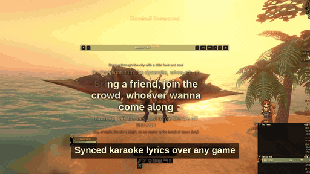
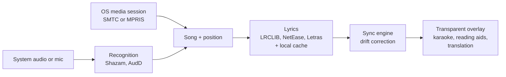

# Singevery

Singevery is a transparent desktop overlay that recognizes the song you are playing and shows synced, karaoke-style lyrics on top of any app or game.

[Español](README.es.md) · [](https://github.com/Grizaceo/Singevery/releases/latest) [](https://github.com/Grizaceo/Singevery/actions/workflows/ci.yml)

<p align="center">
  
</p>

<p align="center"><a href="https://github.com/Grizaceo/Singevery/releases/download/v0.2.1-beta.4/singevery-trailer.mp4">▶ Watch the full trailer with sound (68 s, MP4)</a></p>

## Status

Public beta. It runs on **Windows (x64)** and **Linux (x64, Wayland or X11)**; the Linux build is tested on Hyprland. The interface is in English by default, with Spanish available in Settings. Free and open source.

## Quickstart

1. Download the latest build from **[Releases](https://github.com/Grizaceo/Singevery/releases/latest)**:
   - **Windows:** `Singevery-Setup-x.y.z.exe`. The installer is not code-signed, so SmartScreen may say *"Windows protected your PC"*: click **More info → Run anyway**.
   - **Linux:** `Singevery-x.y.z-x86_64.AppImage` (`chmod +x` it and run it), or the `.tar.gz`. Details in [`apps/desktop/LINUX.md`](apps/desktop/LINUX.md) (Spanish).
2. Play music (Spotify, a browser, a game…) and click the **SING** pill, or press **Ctrl+Alt+S**.
3. The song is recognized in a few seconds and the lyrics follow it. Open **⚙ Settings** to change color, size, opacity and more.

From source (needs a recent Node.js LTS):

```bash
git clone https://github.com/Grizaceo/Singevery.git
cd Singevery/apps/desktop && npm install
npm run dev:electron
```

## What it does

- **Recognizes the song** from system audio or the microphone. Shazam goes first (free, no key), and [AudD](https://audd.io) is the fallback if you add your own token. It also reads your player (SMTC on Windows, MPRIS on Linux) to know the exact position.
- **Synced karaoke lyrics**, word by word, with drift correction and manual sync controls (jump lines, offset, global calibration).
- **Reading aids** for languages you can't read yet, shown on top of the original lyrics:

| Language / script | What you get |
|---|---|
| Japanese | Furigana, romaji (Hepburn), kana-only mode, IPA |
| Korean | Revised Romanization, per word |
| Chinese | Pinyin per character (tone marks optional) |
| Cyrillic | Latin romanization, per word |
| Spanish · Italian · French · German · English (US) | IPA transcription, with a guide for every symbol |

- **Live translation**, under the current line or side by side with the lyrics. MyMemory works with no setup, with a small free daily quota (more if you add an email). DeepL or Google work with your own key. You can also translate offline with a local model ([Hy-MT2](docs/HYMT2_TRANSLATION.md)) served by your own llama.cpp, LM Studio or Ollama.
- **Make it yours:** lyric color (presets, any custom color, or automatic contrast), text size, separate lyric and background opacity, visible lines and alignment. You can also change the handle's color, size and position, pick which buttons are shown, and turn on a mirror mode for projecting onto glass.
- **Stays out of your way:** a click-through mode lets your clicks reach the game or app behind the lyrics. Toggle it with **Ctrl+Alt+T**, or let it turn on after a while without touching the widget. The window also collapses into a small **SING** pill.
- **Practice tools:** a pitch monitor against the song's melody, saved lines for review, and CSV export.

## How it works



The app is Electron + React + TypeScript and lives in [`apps/desktop`](apps/desktop). The main process captures audio, talks to the recognizers and lyric providers, keeps a local cache and runs the sync engine; the renderer draws the overlay. Reading aids are computed locally: kuromoji for Japanese, CMUdict for English IPA, and rule-based engines for the other IPA languages. Audio clips are sent to the recognizer only to identify the song; the app never saves recordings to disk.

```
apps/desktop/   Electron app (main process + React renderer), tests in apps/desktop/tests
native/smtc/    C# (.NET 8) sidecar that reads the Windows media session
docs/           Guides, design notes and audits (docs/archive/ holds older plans)
legacy/         Archived Python prototype, not maintained
```

## How this was built

Cristóbal (GitHub: Grizaceo) designed Singevery and decided what it does and what gets merged. He reviewed each change by using the app, testing it by hand on his own Windows and Linux (Hyprland) machines. A large part of the code was written by AI coding assistants, including Claude Code and Devin, working from his instructions.

What was verified: the unit and regression tests run in CI on every push, and the Windows installer is only published when lint, tests and a launch smoke test pass. What was not verified automatically: there are no end-to-end tests of song recognition or of the overlay on screen, so those were only checked by hand.

## Limits

- **Beta.** Expect rough edges; please [open an issue](https://github.com/Grizaceo/Singevery/issues) when something breaks. Settings → Other → Help & beta prepares a report you review before sending.
- **Unsigned installer.** Windows SmartScreen warns the first time. Each release lists the installer's SHA-256 so you can verify the download.
- **Linux click-through needs Hyprland.** On other Wayland compositors the overlay works, but clicks don't pass through it. macOS is not supported.
- **Recognition depends on third-party services.** Shazam is used through an unofficial client and may stop working; AudD needs your own token.
- **Lyrics are not always available or synced**: they come from public providers and coverage varies by song and language.
- **IPA is exact for Spanish, Italian and Japanese and approximate for French, German and English**: details in [`docs/IPA_LENGUAS_LATINAS_2026-08-04.md`](docs/IPA_LENGUAS_LATINAS_2026-08-04.md) (Spanish).
- **The local translation model is not bundled**: you need to run your own llama.cpp, LM Studio or Ollama server.
- **Some documentation is only in Spanish** for now: the [user guide](GUIA_DE_USO.md), the [legal notice](AVISO_LEGAL.md) and the Linux and Windows notes.

## License

[Apache-2.0](LICENSE) © 2026 Gris. Third-party licenses are generated in `apps/desktop/build/THIRD-PARTY-NOTICES.txt` and installed with the app. How releases are made: [`docs/RELEASING.md`](docs/RELEASING.md).
